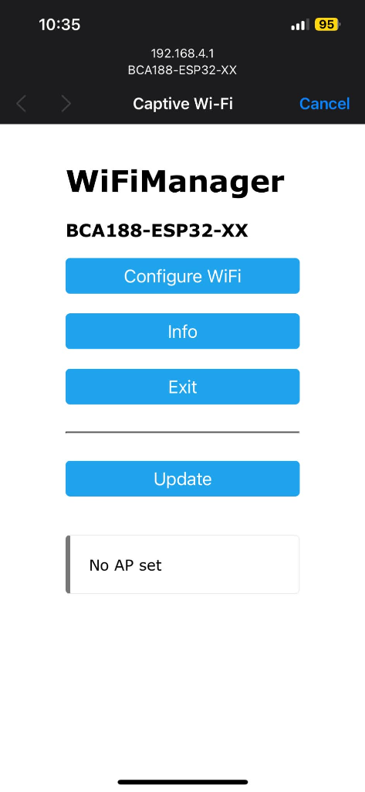
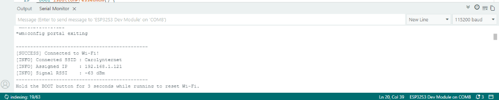

# Laboratory Activity 9: ESP32 Wi-Fi Manager

**Name:** Michael Cadiz  
**Assigned Number:** XX  

---

## Results Table

| Task | What to do | What you observe |
| :--- | :--- | :--- |
| **1. Wrong password** | Enter a wrong password on the setup page. | The ESP32 failed to authenticate with the router, kept the configuration portal open until the 180-second timeout expired, and then restarted back into AP mode without locking up. |
| **2. Reset settings** | Hold the BOOT button for 3 seconds while the board is running. | The ESP32 detected the 3-second button press, wiped the saved Wi-Fi credentials from NVS flash memory, and restarted back into Access Point mode (`BCA188-ESP32-XX`). |
| **3. Change the name** | Change the network name, upload, and check your phone's Wi-Fi list. | After modifying the SSID in the code and uploading, the old network name disappeared and the new SSID immediately appeared in the phone's Wi-Fi list. |
| **4. Different network** | Reset the board, then connect to your phone hotspot. | The ESP32 opened the captive portal, connected to the phone hotspot after submitting credentials, and acquired a new IP address under the hotspot subnet without any code change. |

---

## Screenshots

### Setup Page on Phone

### Serial Monitor Showing Connected State with IP Address

---

## Explanation

The board connected to a different network without a code change because WiFiManager dynamically saves Wi-Fi credentials into the ESP32's Non-Volatile Storage (NVS Flash memory) via a web captive portal, decoupling network parameters from the compiled firmware.
